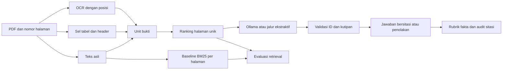

# Rencana A1 · Kirana Document Intelligence

## Hasil yang harus bisa didemokan

Analis investor relations memasukkan PDF dan bertanya dalam bahasa Inggris. Sistem mengembalikan jawaban singkat beserta nomor halaman PDF dan kutipan yang dapat diperiksa, atau menjelaskan bukti yang belum tersedia. Perilaku yang paling penting adalah membedakan angka yang mirip tetapi memiliki tahun, unit, entitas, atau status yang berbeda. Contohnya, belanja modal aktual 2025 berbeda dari rencana 2026, dan angka 96 dalam surat CEO dikoreksi menjadi 82 dalam errata.

Brief meminta seluruh PDF diproses, antarmuka untuk bertanya, jawaban bersitasi, penolakan yang jujur, 15–20 pertanyaan dengan jawaban dan halaman referensi, hasil retrieval yang terpisah dari kualitas jawaban, serta jalur untuk PDF baru tanpa perubahan kode. Berkas submission mencakup repo, README dengan cara menjalankan dalam paling banyak lima perintah dan paragraf penggunaan AI, hasil evaluasi beserta kegagalan, serta ringkasan satu halaman untuk pemilik bisnis. [Brief resmi A1](https://drive.google.com/file/d/1MggEmSSjA3SPuDy9FGTDhR7NG0tgn0zi/view)

## Desain dan urutan pengerjaan

| Tahap | Keputusan | Bukti bahwa tahap siap |
| --- | --- | --- |
| 1 · Inventaris PDF | Catat setiap halaman fisik. Periksa teks asli, geometri tabel, dan area gambar. Deteksi halaman yang terlihat punya teks karena footer padahal isinya scan. | Manifest mencakup 13 halaman dan menjelaskan jalur ekstraksi atau keterbatasan setiap halaman. |
| 2 · Ekstraksi dengan asal bukti | Ekstrak paragraf per blok. Pertahankan nama kolom, tahun dan unit di baris tabel. Jalankan OCR pada area visual yang dapat dibaca. Simpan halaman, jenis sumber, dan koordinat jika tersedia. | Satu kutipan dapat dilacak kembali ke bagian yang sesuai, termasuk p4, p8, dan tarif scan p13 bila OCR berhasil. |
| 3 · Retrieval yang dapat dibandingkan | Baseline memakai BM25 atas teks satu halaman. Kandidat memakai unit yang mengikuti struktur halaman dan menggabungkan skor kembali ke halaman unik. Pertahankan batas lima halaman untuk kedua varian. | Ranking, potongan bukti, dan skor dapat diperiksa. Evaluasi menunjukkan perbedaan nyata dan mencatat apakah perbedaan berasal dari OCR, struktur, atau ranking. |
| 4 · Jawaban dan penolakan | Gunakan generator lokal jika tersedia dan minta jawaban terstruktur dengan referensi ke ID bukti. Resolusi sitasi dilakukan di kode. Saat bukti ambigu, kutip konflik dan dahulukan koreksi resmi yang eksplisit. Saat bukti tidak cukup, kembalikan status penolakan. Siapkan jalur ekstraktif untuk demo tanpa model. | Pertanyaan tentang 96 dan 82 mengembalikan relasi yang benar dengan bukti errata. Pertanyaan CFO, diskon Schedule C, dan aktual 2026 ditangani tanpa menebak. |
| 5 · Pengukuran dan serah terima | Jalankan baseline dan kandidat pada gold set yang sama. Periksa output berisiko terhadap halaman sumber. Uji PDF sintetis baru melalui jalur publik aplikasi. Simpan perintah, konfigurasi dan output per kasus. | Demo dapat diulang, kegagalan dijelaskan, dan reviewer dapat membandingkan bukti dengan jawaban. |

Prioritas untuk anggaran enam jam dari brief. Sisihkan kira-kira 40 menit untuk inventaris dan kontrak bukti, 75 menit untuk ekstraksi dan baseline, 90 menit untuk jawaban dan sitasi, 80 menit untuk evaluasi dan perbaikan paling berdampak, lalu 55 menit untuk demo, dokumentasi dan buffer. Gold set dan harness dikerjakan paralel dengan aplikasi. Jika waktu menyusut, pertahankan CLI, teks dan tabel, jalur penolakan, manifest, dan evaluasi. Catat kelas visual yang belum terbukti. Tambahkan OCR atau dukungan visual berdasarkan kasus konkret, seperti tarif scan atau kartu NPS.

### Kontrak data dan keputusan teknis

- Setiap unit bukti membawa nomor halaman fisik 1-based, teks, jenis ekstraksi dan ID internal. Kolom dan label tabel harus tetap terhubung ke nilainya. Pada gambar, koordinat dan asosiasi spasial lebih berguna daripada urutan teks OCR saja.
- Indeks tetap lokal dan dapat dibangun ulang dari file yang diberikan pengguna. PDF baru melalui ekstraksi yang sama. Nilai Kirana dan jawaban gold hanya masuk ke data evaluasi.
- Ambil konteks per halaman dengan sejumlah unit terbaik. Pertahankan dokumen, periode, entitas, dan satuan yang ditanya. Halaman yang menyebut topik bisa tetap tidak memiliki angka yang dibutuhkan, seperti halaman 7 yang menyebut Cibitung tanpa utilisasi 96%.
- Model memilih bukti yang tersedia dari konteks. Kode menolak referensi yang tidak bisa dipetakan ke sumber. Kutipan valid membuktikan asal teks. Dukungan faktual tetap diperiksa terpisah, terutama pada hubungan label grafik, tahun dan kolom tabel, atau dua angka yang bertentangan.
- Render visual sebagai bagian inspeksi. OCR dapat membaca tulisan pada grafik, tetapi urutan baris OCR tidak membuktikan bahwa suatu angka milik bar Q4. Periksa hubungan spasial atau tandai ketidakpastian sebelum memberi jawaban.
- Pertahankan baseline BM25 yang mudah dijelaskan. Lanjutkan ke dense retrieval atau reranker jika analisis menunjukkan istilah semakna gagal menemukan bukti. Biaya tambahan harus bisa dibandingkan dengan perubahan hasil.

## Evaluasi

Gold set berisi 20 pertanyaan bahasa Inggris, terdiri dari 16 yang bisa dijawab dan empat yang membutuhkan penolakan. Setiap pertanyaan berisi fakta wajib, variasi jawaban yang diterima, dan halaman alternatif yang mendukung tiap fakta. Ada teks naratif, tabel, dua pertanyaan lintas halaman, errata, kartu NPS, grafik Q4 dan tabel tarif scan. Untuk pertanyaan yang tidak terjawab, catat bukti yang tampak dekat dan alasan bukti itu tidak cukup. Contohnya, tarif dasar p13 tersedia, sedangkan diskon volume dirujuk ke Schedule C yang tidak disertakan.

| Aspek | Metrik dan denominator | Rujukan |
| --- | --- | --- |
| Penemuan bukti | **Evidence-group Recall@5**. Untuk setiap pertanyaan yang bisa dijawab, hitung proporsi fakta yang memiliki setidaknya satu halaman pendukung dalam lima halaman unik, lalu rata-ratakan per pertanyaan. **All Evidence@5** adalah proporsi kasus yang menemukan seluruh kelompok bukti. | [UniDoc-Bench, Findings of EMNLP 2026](https://aclanthology.org/2026.findings-emnlp.534/) mengukur retrieval pada level dokumen dan halaman. Kelompok alternatif dan cutoff 5 adalah adaptasi lokal. |
| Urutan hasil | **nDCG@5**. Halaman relevan diberi label biner dari gabungan halaman emas. Jumlahkan relevansi pada posisi i dengan diskon 1/log₂(i+1), bagi dengan ranking ideal, lalu rata-ratakan pada 16 kasus yang bisa dijawab. | [ViDoRe v2](https://arxiv.org/abs/2505.17166) menggunakan nDCG@5. [ViDoRe v3, 2026](https://arxiv.org/abs/2601.08620) melaporkan NDCG@10 dan memeriksa perbedaan antarjenis bukti. |
| Kebenaran jawaban | **Atomic fact recall** memberi kredit parsial atas fakta yang ditemukan. **Strict answer pass** menuntut seluruh fakta wajib pada satu kasus. Pemeriksa alias memberi hasil otomatis yang dapat diulang. Audit manual menilai hubungan fakta, tahun dan satuan, klaim yang ditambahkan, dan apakah angka lama disebut sebagai koreksi. | [GDP.pdf, 2026](https://arxiv.org/abs/2607.11192) melaporkan skor rubrik atomik dan strict pass. [RAGChecker](https://proceedings.neurips.cc/paper_files/paper/2024/hash/27245589131d17368cccdfa990cbf16e-Abstract-Datasets_and_Benchmarks_Track.html) mendiagnosis retrieval dan generation pada tingkat klaim. |
| Kualitas sitasi | **Page precision** menghitung proporsi halaman yang dikutip yang cocok dengan halaman gold. **Citation completeness** memeriksa apakah tiap fakta wajib memiliki minimal satu halaman pendukung yang dikutip. Audit kutipan memeriksa apakah potongan yang ditunjuk benar-benar mendukung fakta. | [ALCE](https://aclanthology.org/2023.emnlp-main.398/) menilai dukungan dan relevansi sitasi pada tingkat klaim. Skor page hit di proyek ini adalah proxy. |
| Perilaku menolak | **Abstention recall** adalah penolakan benar dibagi empat pertanyaan yang tidak bisa dijawab. **False abstention rate** adalah penolakan pada 16 kasus yang bisa dijawab. **Coverage** menghitung bagian yang dijawab dari 20 kasus. **Selective error** menghitung jawaban yang salah di antara kasus yang dijawab, termasuk jawaban atas kasus tak terjawab. | [Selective Question Answering under Domain Shift](https://aclanthology.org/2020.acl-main.503/) menghubungkan risiko dan cakupan. Laporkan titik operasi yang digunakan dalam demo. |

### Protokol menjalankan evaluasi

1. Kunci PDF dan gold set sebelum membandingkan konfigurasi. Simpan hash, versi model, k, mode OCR, dan mode retrieval bersama output. Pertahankan teks pertanyaan saat mengecek baseline dan kandidat.
2. Jalankan retrieval pada 16 kasus yang memiliki bukti. Bandingkan hasil per kasus dan kelompok konten. Gunakan data ekstraksi yang sama jika ingin mengisolasi strategi ranking. Jika baseline memakai teks asli dan kandidat juga memakai OCR, laporkan perbandingannya sebagai perubahan pipeline gabungan.
3. Jalankan QA pada seluruh 20 kasus. Catat jumlah absolut di samping persentase. Audit minimal kasus errata, lintas halaman, semua modalitas visual dan semua jawaban atas pertanyaan tanpa bukti. Pada sampel sekecil ini, satu kasus bisa mengubah strict pass sebesar 6,25 poin persentase.
4. Lacak kegagalan mengikuti urutan **ekstraksi → ranking → pemilihan potongan → jawaban → sitasi**. Saat halaman benar masuk top-5 tetapi potongan tidak memuat nilai, periksa potongan yang dikirim ke model. Saat bukti lengkap tersedia tetapi jawaban salah, periksa pengikatan entitas, waktu, satuan, atau konflik. Jika perlu, uji ulang dengan menyuplai bukti gold sebagai diagnosis tambahan.
5. Uji ulang setelah satu perubahan yang punya hipotesis. Label hasil Kirana sebagai evaluasi atas satu laporan. Uji PDF sintetis baru memeriksa jalur umum aplikasi. Kemampuan pada dokumen perusahaan kedua tetap perlu diukur pada demo.

### Cara memutuskan apakah perubahan layak dipertahankan

| Hasil pengukuran | Keputusan |
| --- | --- |
| Recall membaik, jawaban tetap salah | Periksa apakah unit yang dikirim mengandung fakta dan labelnya. Tambahkan konteks atau perbaiki ekstraksi sebelum mengubah model. |
| Recall setara, nDCG naik | Periksa apakah halaman yang naik benar-benar menyuplai fakta yang dibutuhkan. Kenaikan urutan berguna bila konteks yang relevan lebih sering sampai ke generator atau lebih mudah diperiksa. |
| Coverage naik bersama kesalahan | Tinjau pertanyaan yang baru dijawab, terutama aktual versus rencana dan lampiran yang absen. Pilih titik operasi yang mengutamakan jawaban akurat dan jelaskan konsekuensinya. |
| Alias lulus, kutipan tidak mendukung | Catat sebagai gagal pada audit. Periksa relasi angka dengan periode, entitas dan unit. Perbaiki pemilihan bukti dan jalankan ulang. |
| Hanya satu kasus berubah | Laporkan ID kasus dan contohnya. Hindari klaim peningkatan umum sampai ada PDF kedua dan pertanyaan yang tidak dipakai untuk diagnosis. |

Untuk demo, prioritaskan hasil yang bisa diperiksa langsung. Buka errata dan tunjukkan angka yang dikoreksi, buka tabel untuk memeriksa tahun atau negara, lalu tanyakan diskon Schedule C untuk menunjukkan perilaku saat bukti tidak ada. Jika salah satu kasus gagal, pakai hasil aktual untuk menjelaskan apakah masalahnya ada di OCR, konteks yang dipilih, atau jawaban.

## Pemeriksaan sebelum demo

- Jalankan dari setup baru dengan PDF resmi dan satu PDF baru. Periksa nomor halaman fisik, urutan ranking, dan bahwa proses berjalan saat model lokal tidak tersedia.
- Tunjukkan satu lookup tabel, satu jawaban dengan dua sumber, dan kasus errata. Lanjutkan dengan pertanyaan Schedule C untuk menunjukkan penolakan meski PDF memberi tarif dasar.
- Laporkan jalur visual yang berhasil dan yang masih gagal. Tinjau angka p3, p5, dan p13 langsung pada halaman, terutama jika teks OCR mengubah koma, titik, atau label.
- Pastikan reviewer dapat membuka potongan bukti, menelusuri perbedaan antara skor otomatis dan audit, dan menjalankan ulang perintah. Simpan data assignment hanya untuk keperluan seleksi.

## Pembagian kerja

| Pemilik | Tanggung jawab |
| --- | --- |
| Luna xhigh · Build | Paket aplikasi, ekstraksi, retrieval, aturan jawaban dan CLI. |
| Luna xhigh · Testing | Harness evaluasi, metrik, tes kontrak, uji PDF baru dan hasil yang dapat diulang. |
| Orkestrator | Brief dan literatur, gold set dari PDF resmi, koordinasi kontrak, audit hasil, dokumentasi dan pemilihan konfigurasi demo. |
